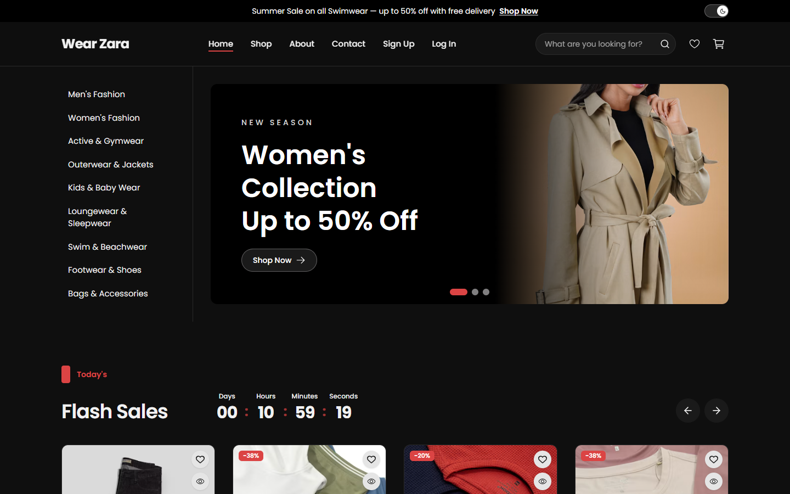
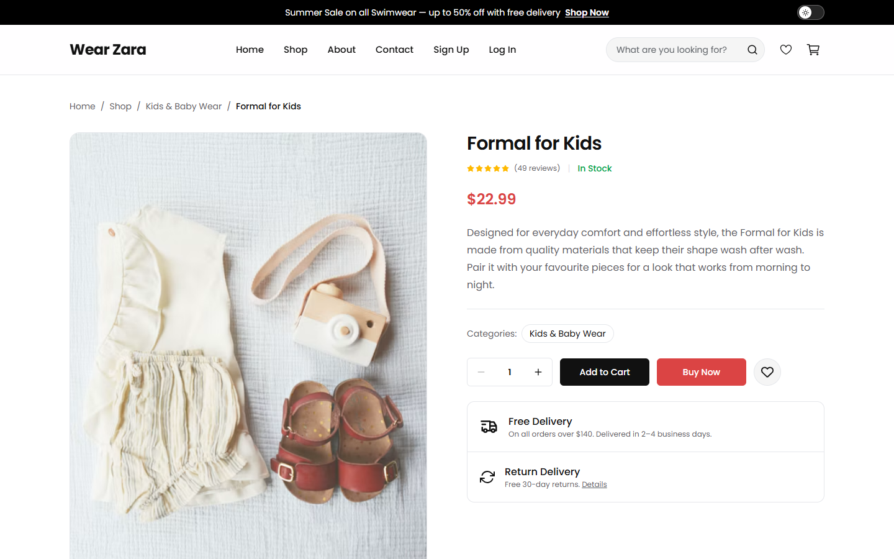

# Wear Zara — Full-Stack Fashion E-commerce

A modern, responsive online fashion store built with **Next.js 16 (App Router)**, **React 19**, **Tailwind CSS 4**, **Prisma**, **PostgreSQL** and **Auth.js**.

**Live demo:** https://wear-zara.vercel.app


---

## ✨ Features

### Shopping
- **Product catalogue** served from PostgreSQL — 12 categories, many-to-many product ↔ category relations
- **Shop page** with category filters, search, sorting (newest, price, name) and crawlable pagination
- **Product details pages** with related items, SEO metadata and JSON-LD structured data
- **Quick view** modal, live **cart & wishlist** with badges, synced across tabs
- **Cart** with quantity controls, coupon codes (`WELCOME10`, `ZARA20`), free-delivery threshold and totals
- **Checkout** with validated billing form and order confirmation (cash on delivery)
- Flash-sale and promo **countdowns** that roll over automatically (weekly / monthly)

### Accounts & admin
- **Sign up / log in** with Auth.js (credentials), bcrypt-hashed passwords and JWT sessions
- Account menu with **log out** and **delete account**
- **Admin dashboard** — create/delete categories, publish/delete products, live image preview
  - Restricted to emails listed in `ADMIN_EMAILS`; everyone else sees a **read-only demo**
  - Every write API route is protected server-side

### Quality
- **Light / dark / system theme** with no flash on load
- Fully **responsive**, mobile-first layouts and touch-friendly product cards
- **Accessible**: semantic landmarks, skip link, keyboard-friendly dialogs (native `<dialog>`), labelled icon buttons, live regions for toasts
- **Fast**: static home page with incremental revalidation, responsive images, `next/font`
- **SEO**: per-page metadata, Open Graph image, `sitemap.xml`, `robots.txt`
- Custom **404** and **error** pages, loading skeletons

---

## 📸 Screenshots

| Dark mode | Product page | Mobile |
| --- | --- | --- |
|  |  |  |

---

## 🛠️ Tech Stack

| Area | Technology |
| --- | --- |
| Framework | Next.js 16 (App Router, Server Components, Route Handlers) |
| UI | React 19 + React Compiler, Tailwind CSS 4, react-icons |
| Database | PostgreSQL (Neon) with Prisma ORM |
| Auth | Auth.js (NextAuth v5) — credentials provider, bcrypt |
| Theming | next-themes |
| Deployment | Vercel |

---

## 📁 Project Structure

```
src/
├── app/                    # Routes (App Router)
│   ├── page.jsx            # Home
│   ├── shop/               # Catalogue with filters, search, sort, pagination
│   ├── product/[id]/       # Product details
│   ├── cart/ checkout/ wishlist/
│   ├── login/ signup/ about/ contact/ faq/ admin/
│   └── api/                # Route handlers (products, categories, auth, user)
├── components/
│   ├── ui/                 # Reusable primitives: Button, Modal, FormField, Toast, Stars…
│   ├── product/            # ProductCard, ProductGrid, ProductRail, QuickView…
│   ├── layout/             # Navbar, Footer, ThemeToggle, Providers
│   ├── home/ shop/ cart/ auth/ admin/ contact/
├── lib/                    # Data access, cart store, formatting, validation, config
└── auth.js                 # Auth.js configuration
prisma/
├── schema.prisma
├── migrations/
└── seed.js                 # Seeds the demo catalogue
```

---

## 🚀 Getting Started

**Prerequisites:** Node.js 20.9+ and a PostgreSQL database (a free [Neon](https://neon.tech) database works great).

```bash
# 1. Clone and install
git clone https://github.com/sharjilsaif/wear-zara.git
cd wear-zara
npm install

# 2. Configure environment variables
cp .env.example .env      # then fill in DATABASE_URL, AUTH_SECRET and ADMIN_EMAILS

# 3. Create the tables and load the demo catalogue
npm run db:migrate
npm run db:seed

# 4. Start the dev server
npm run dev
```

Open http://localhost:3000.

### Environment variables

| Variable | Description |
| --- | --- |
| `DATABASE_URL` | PostgreSQL connection string |
| `AUTH_SECRET` | Secret for signing sessions — generate with `npx auth secret` |
| `ADMIN_EMAILS` | Comma-separated emails allowed to edit the catalogue in `/admin` |

### Scripts

| Command | Description |
| --- | --- |
| `npm run dev` | Start the development server |
| `npm run build` / `npm start` | Production build / server |
| `npm run lint` | Run ESLint |
| `npm run db:migrate` | Apply database migrations |
| `npm run db:seed` | Seed categories and products |

---

## 🗺️ Roadmap

- Online card payments (Stripe)
- Persisted orders & order history
- Product reviews and multiple images per product
- Account-synced cart and wishlist

---

## 👨‍💻 Author

**Sharjil Malik** — [GitHub](https://github.com/sharjilsaif)
