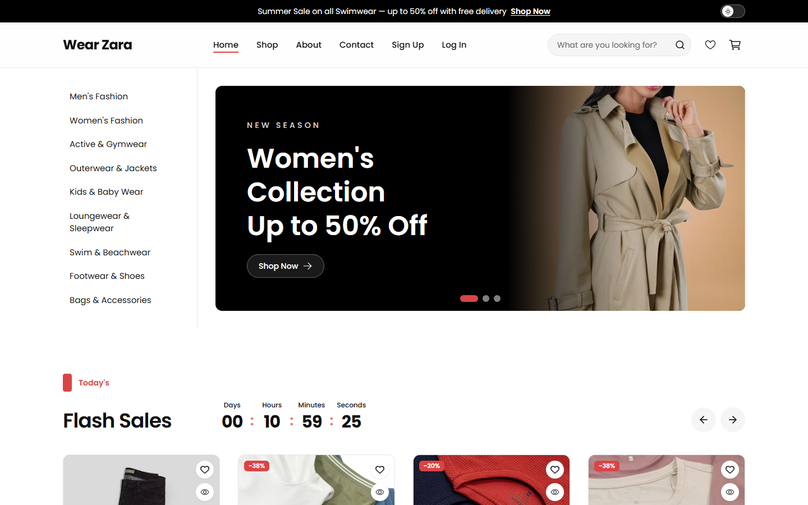
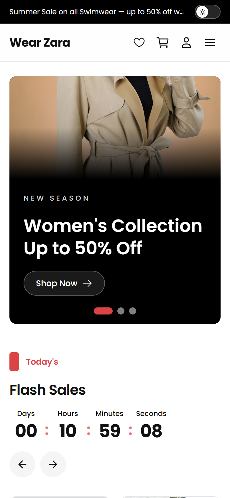

# Wear Zara — Full-Stack Fashion E-commerce

A production-grade online fashion store built with **Next.js 16 (App Router)**, **React 19**, **Tailwind CSS 4**, **Prisma**, **PostgreSQL** and **Auth.js** — in **English, Urdu (right-to-left) and Spanish**, with an Apple-inspired glass design, light/dark themes and a full admin panel.

**Live demo:** https://wear-zara.vercel.app · **Full project report:** [PROJECT_REPORT.md](PROJECT_REPORT.md)



---

## ✨ Highlights

**Shopping** — catalogue with category filters, search, sorting and pagination · product pages with reviews and related items · quick-view sheet · bag and wishlist that **sync to your account across devices** · server-validated coupons · checkout with saved details · order confirmation, tracking (signed-in or by order number + email) and self-service cancellation.

**Accounts** — sign up / sign in, profile photo upload, name and phone editing, password change, account deletion, order history.

**Admin panel** (admins only) — overview stats, orders with status workflow, products (create / edit / delete), categories, coupons (percent or fixed, minimum spend, usage limit, expiry, on/off), customers with photos, carts and wishlists, review moderation, contact-form inbox, newsletter subscribers with CSV export.

**Experience** — English / Urdu / Spanish with full RTL layout, art-directed hero images per screen size, glassmorphism UI, custom dropdowns, accessible dialogs, cookie consent with preferences, store policy pages, size guide, careers, SEO (metadata, sitemap, JSON-LD).

**Security** — bcrypt passwords, JWT sessions, server-side authorisation on every write, admin gate with live session guard, rate limiting, CSRF origin check, strict security headers (CSP, HSTS, frame denial), prices and coupons always re-checked on the server.

---

## 📸 Screenshots

| Dark mode | Product page | Mobile |
| --- | --- | --- |
|  |  |  |

---

## 🛠️ Tech Stack

| Area | Technology |
| --- | --- |
| Framework | Next.js 16 (App Router, Server Components, Route Handlers, Proxy) |
| UI | React 19 + React Compiler, Tailwind CSS 4, react-icons (Lucide) |
| Database | PostgreSQL (Neon) with Prisma ORM |
| Auth | Auth.js v5 — credentials provider, bcrypt, JWT sessions |
| i18n | Custom dictionaries + locale proxy (en / ur / es), Intl formatting |
| Deployment | Vercel |

---

## 📁 Project Structure

```
src/
├── app/
│   ├── [lang]/            # Every page, rendered per language (URLs stay clean: /shop, not /en/shop)
│   │   ├── shop/ product/[id]/ cart/ wishlist/ checkout/ track-order/
│   │   ├── account/       # Profile, orders, order detail
│   │   ├── admin/         # Overview, orders, products, categories, coupons, customers, reviews, messages, subscribers
│   │   └── [page]/        # Shipping, returns, size guide, careers, privacy, terms, cookies
│   └── api/               # 25 route handlers (auth, account, cart, wishlist, orders, coupons, reviews, admin…)
├── components/            # ui/ layout/ home/ product/ cart/ orders/ account/ admin/ auth/ shop/
├── i18n/                  # config, translator, dictionaries (en / ur / es)
├── lib/                   # data access, pricing, validation, store sync, rate limiting, helpers
├── proxy.js               # language routing + API CSRF check
└── auth.js                # Auth.js configuration
prisma/
├── schema.prisma          # 12 models
├── migrations/
└── seed.js                # Demo catalogue
```

---

## 🚀 Getting Started

**Prerequisites:** Node.js 20.9+ and a PostgreSQL database (a free [Neon](https://neon.tech) database works great).

```bash
git clone https://github.com/sharjilsaif/wear-zara.git
cd wear-zara
npm install
cp .env.example .env      # fill in DATABASE_URL, AUTH_SECRET and ADMIN_EMAILS
npm run db:migrate        # create the tables
npm run db:seed           # load the demo catalogue
npm run dev
```

Open http://localhost:3000. Sign up with an email listed in `ADMIN_EMAILS` to unlock `/admin`.

### Environment variables

| Variable | Description |
| --- | --- |
| `DATABASE_URL` | PostgreSQL connection string |
| `AUTH_SECRET` | Secret for signing sessions — generate with `npx auth secret` |
| `ADMIN_EMAILS` | Comma-separated emails that can open the admin panel |

### Scripts

| Command | Description |
| --- | --- |
| `npm run dev` | Development server |
| `npm run build` / `npm start` | Production build / server |
| `npm run lint` | ESLint |
| `npm run db:migrate` | Apply database migrations |
| `npm run db:seed` | Seed categories and products |

---

## 🗺️ Roadmap

- Online card payments (Stripe) and order confirmation emails
- Password reset by email
- Multiple images and size/colour variants per product
- Wear Zara mobile app

---

## 👨‍💻 Author

**Sharjil Malik** — [GitHub](https://github.com/sharjilsaif)
